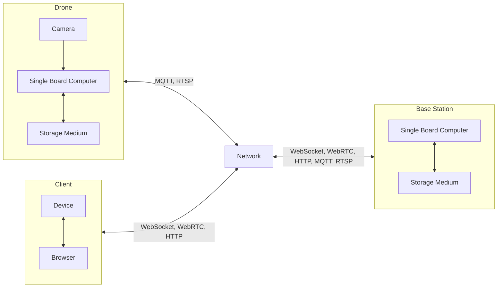

# Group 2: On-Board Data Processing
Integrated Sensors - Levin Uncu, Luka Kühnel, Yasin Atabey

## Project Plan

### Description of Project
The project is part of a larger project aimed at developing a drone for firefighting operations. This sub-project focuses on processing data on board the drone.

The drone is intended to record video footage and analyze it live on board. The task is to detect and classify people, for example whether they are lying down or standing, as well as to identify fires and heat sources. The collected data should then be transmitted to the base station in a suitable format.

Interfaces with other teams also need to be considered, such as weight and available space in coordination with Team 1, or potentially the choice of a common single board computer together with Team 3.

The data transmitted to the base station should be displayed in a user interface whenever a connection to the base station is available.

### Objective
We ensure that the drone can see, understand, and report at the deployment site.

- Record and appropriately store video data
- Analyze video data live on board
  - Detect and classify people (lying down, standing, etc.)
  - Detect fires and heat sources
- Transmit the collected data to a base station from a greater distance
- Visualize the available data in a user interface with an option to download it

### Task Table
- **Person 1**: Image Recognition and AI Models
- **Person 2**: Camera + IR Data Processing on the Drone (Collection + Storage)
- **Person 3**: Transmission and Base Station Software

| Task | Dependencies | Phase for parallel tasks | Responsible |
|----------|----------|--------|---|
| Hardware for video recording -> camera and infrared sensor (research and ordering) | 1-(What is available to us: space and weight?) | 1 | 1, 2 |
| Obtain storage medium for video recordings |  | 1 | 2 |
| Hardware for project logic, data transmission or communication with the base station, and data processing -> single board computer and transmission and reception module (research and ordering) | 1-(Which single board computer where?) | 1 | 3 |
|----------|----------|--------|--------|
| Research on image recognition models (consider: computing power, power consumption) |  | 2 | 1 |
| Connect and test storage media |  | 2 | 2 |
| Connect camera to single board computer and test it |  | 2 | 2 |
| Connect and test transmission and reception module (drone/base station) |  | 2 | 3 |
|----------|----------|--------|--------|
| Define data scope (video format, labels for models, etc.) |  | 3 | 1, 2 |
| Receive drone status (position) from Team 1 for e.g. starting the video recording | 1-(How is drone status received?) | 3 | 3 |
|----------|----------|--------|--------|
| Training of image recognition models |  | 4 | 1 |
| Store video data on the drone (compressed) |  | 4 | 2 |
| Define message structure for transmission |  | 4 | 3 |
|----------|----------|--------|--------|
| Training of image recognition models (further) |  | 5 | 1 |
| Connect camera data to model and, if necessary, retrain the models |  | 5 | 1, 2 |
| Store transmitted data (video and model) at the base station |  | 5 | 3 |
| Connection between client/base station for UI |  | 5 | 3 |
|----------|----------|--------|--------|
| Test classification by the models |  | 6 | 1 |
| Test camera functionality and data storage |  | 6 | 2 |
| Test transmission between drone and base station |  | 6 | 3 |
|----------|----------|--------|--------|
| Integration of our system with results from other teams | 1-(Assembly of drones) | 7 | 1, 2 |
| Camera Data and Classification Improvements | | 7 | 1, 2 |
| UI visualization of the received data |  | 7 | 3 |
| UI download function |  | 7 | 3 |
|----------|----------|--------|--------|
| General rehearsal of functionality | 1&2-(Testing the overall functionality) | 8 | 1, 2, 3 |
| Adjustments after the general rehearsal, if necessary |  | 8 | 1, 2, 3 |

## One Picture Overview

## Hardware List
First we need two cameras:
- MLX90640BAB IR Thermalkamera Modul 32x24 FOV 55x35°
- Raspberry Pi Camera Module 3 Wide, 12MP

We need single board computers, one for the drone, one for the base station:
- RaspberryPi 5
- RaspberryPi Zero 2 W

For storage, we need a microSD card with enough capacity to store both the operating system and the drone data. If a single card does not provide enough storage, we would need to use two separate cards.